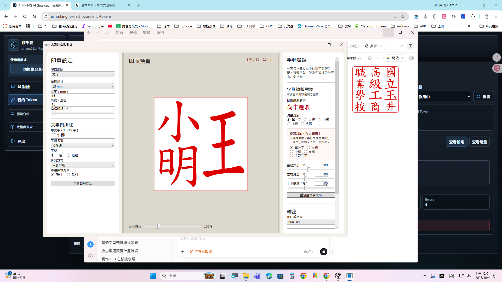
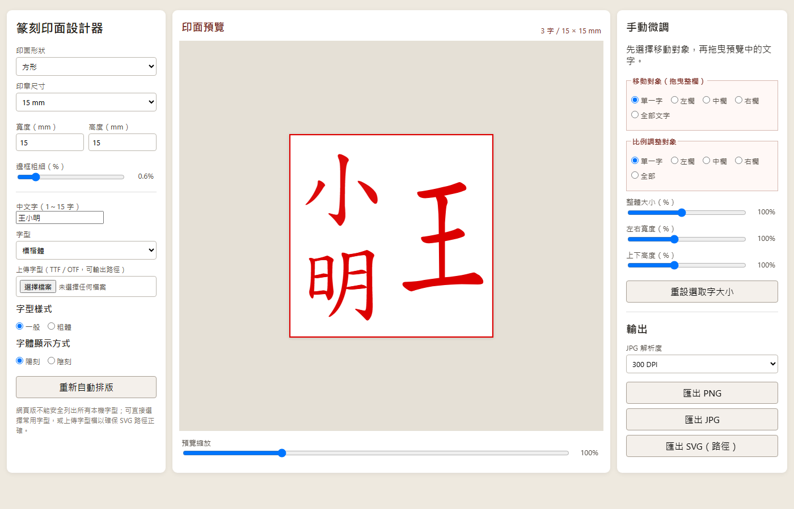

# 篆刻印面設計器

Windows 桌面版篆刻印面設計工具，適合製作傳統方章印面圖稿，並輸出給後續加工使用。

## 下載

請到 [Releases](https://github.com/chang514/SealDesigner/releases/latest) 下載最新版本。

主要檔案：

- `SealDesigner_Portable_win-x64_20261004.zip`：Windows 10／11 64 位元免安裝版
- `SealDesigner_Web_20261004_v3.zip`：可直接用瀏覽器開啟的網頁版

## Windows 免安裝版操作方式

1. 從 Releases 下載 `篆刻印面設計器_免安裝版_win-x64_20261004.zip`。
2. 在下載的 ZIP 檔上按滑鼠右鍵，選擇「全部解壓縮」。
3. 開啟解壓縮後的資料夾。
4. 雙擊 `啟動篆刻印面設計器.bat`，或直接雙擊 `SealDesigner.exe`。
5. 若 Windows SmartScreen 顯示提示，請確認檔案來源後選擇「其他資訊」→「仍要執行」。

本版本已包含 .NET 8 執行環境，不需要另外安裝 .NET，也不需要安裝程式。程式會讀取目標電腦已安裝的 Windows 字型；不同電腦可使用的字型清單可能不同。

## 基本操作

### 1. 設定印面

- 選擇方形或圓形印面。
- 選擇 10、15、20、25 mm，或輸入自訂尺寸。
- 輸入 1～15 個中文字。
- 選擇字型與一般／粗體。
- 選擇陰刻或陽刻。
- 邊框預設為最細，並且從最外圍滿版開始。

### 2. 自動排版

按「重新自動排版」後，程式會依傳統篆刻閱讀方向排列：

- 右欄先讀，欄內由上到下。
- 再向左排列其他欄位。
- 三字姓名採右欄姓氏、左欄名字上下排列。
- 4～15 字依右、 中、左欄配置自動排列。
- 多字會盡量使用共同字級，避免個別中文字忽大忽小。

### 3. 移動文字

在右側「移動對象（拖曳整欄）」選擇：

- 單一字
- 左欄
- 中欄
- 右欄
- 全部文字

選擇後，直接拖曳預覽中的任一字即可移動選定範圍。

### 4. 調整字形比例

在右側「比例調整對象」選擇單一字、左欄、中欄、右欄或全部，再調整：

- 整體大小：同步放大或縮小
- 左右寬度：只改變橫向寬窄
- 上下高度：只改變縱向高低

調整結果會立即反映在預覽中。若要回復，按「重設選取字大小」。

### 5. 調整預覽大小

預覽區下方的「預覽縮放」只改變畫面顯示大小，不會改變實際輸出尺寸。

### 6. 輸出檔案

- PNG：適合一般預覽與影像加工。
- JPG：可選擇 300、600 或 1200 DPI。
- SVG（路徑）：適合向量加工與後續編輯。

輸出前請確認文字沒有碰到邊框，並確認陰刻／陽刻方向正確。

## 網頁版

網頁版資料夾解壓縮後，直接以 Chrome 或 Edge 開啟 `index.html` 即可使用，不需要安裝程式。

網頁版支援文字輸入、傳統排列、欄位移動、比例調整與 PNG／JPG／SVG 輸出。瀏覽器基於安全限制，不能完整列出所有本機字型；若要確保 SVG 文字轉成正確路徑，請在「上傳字型」欄位載入 TTF／OTF 字型檔。

## 操作畫面

### Windows 桌面版

### 多字自動排列

### 網頁版

## 系統需求

- Windows 10 或 Windows 11
- 64 位元處理器與作業系統
- 約 100 MB 可用空間
- 螢幕解析度建議 1280×720 以上

## 注意事項

- 免安裝版目前提供 Windows x64 版本；不適用於 32 位元 Windows 或 macOS。
- 字型的使用權取決於字型本身授權。程式不會重新散布 Windows 系統字型。
- 本工具產生的是印面圖稿，不會直接控制雕刻機或 CNC 設備。
- 實際雕刻前，請依加工設備需求確認黑白方向、尺寸與解析度。

## 版本

目前版本：`2026.10.04`
